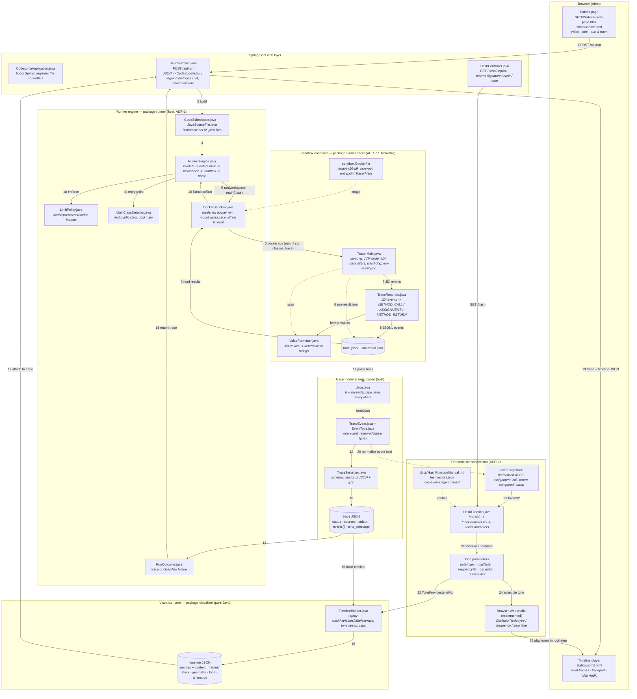

# From Submitted Code to a HashFunction Tone — Data-Flow Diagram

This page traces one submission end-to-end: **browser → Spring endpoint → runner
engine (host) → Docker sandbox (compiler + JDI tracer) → trace model → Java
timeline builder → `HashFunction.java` tone specs → browser player**.

- Rendered graph: `Diagrams/Code-to-HashFunction-Dataflow.{png,svg,pdf}`
- Graphviz source: `Diagrams/Code-to-HashFunction-Dataflow.dot`
- Mermaid source: `Diagrams/Code-to-HashFunction-Dataflow.mmd`



## Step-by-step: what happens, and which file does it

### 1. Submission (browser)
- **`Stitch/Submit-code-page.html`** and the wired-up
  **`src/main/resources/static/submit.html`** hold the editor. **Run & trace**
  POSTs `{files:[{fileName, source, isMainFile}]}` to `/api/run`, then paints the
  returned timeline (active line, stack, variables, arrays, stdout, event list)
  and plays its tone specs.

### 2. Web layer (Spring Boot)
- **`CodexoniaApplication.java`** boots Spring and registers the controllers.
- **`PageController.java`** serves the clean URLs (`/`, `/submit`, `/docs`, …) by
  forwarding to the static HTML files; `/submit` is the editor page.
- **`RunController.java`** (`POST /api/run`) turns the JSON into a
  `CodeSubmission`. If a single `source` is sent instead of `files[]`, it sniffs
  the `public class` name with a regex and wraps it as `ClassName.java`. It then
  calls `new RunnerEngine().run(submission)`, builds the timeline with
  `TimelineBuilder.build(...)`, and returns the trace JSON with the timeline
  attached (or a trace-shaped classified error with an empty timeline).
- **`HashController.java`** (`GET /hash?input=...`) is a separate, standalone
  window onto the same tone logic — useful for verifying the contract.

### 3. Runner engine facade (host)
- **`CodeSubmission.java`** + **`JavaSourceFile.java`** — immutable model of the
  submitted files and their sizes.
- **`RunnerEngine.java`** — the orchestrator: enforce limits → detect main class
  → write a temp workspace (`src/`, `classes/`) → run the sandbox → read back
  `trace.jsonl` → serialize → return a `RunOutcome`. The workspace is always
  deleted afterwards.
- **`LimitPolicy.java`** — memory/CPU/process/wall-clock/event/file-count/tmpfs
  bounds and the sandbox image name.
- **`MainClassDetector.java`** — regex-locates the
  `public static void main(String[])` and resolves the fully-qualified class
  (handling packages and preferring the class matching the file name).
- **`DockerSandbox.java`** — builds the hardened `docker run` command
  (`--network none`, memory/cpu/pids caps, `--read-only`, `--cap-drop ALL`,
  `no-new-privileges`, non-root, tmpfs, SELinux `:Z` bind mount), streams docker
  output, kills the container on wall-clock timeout, and parses
  `run-result.json` back into a `SandboxRun`.
- **`RunOutcome.java`** — either a successful trace (JSON + gzip + event count)
  or a classified failure (`COMPILE_ERROR`, `TIMEOUT`, `NO_MAIN_METHOD`, …).

### 4. Sandbox container (`runner.tracer`)
- **`sandbox/Dockerfile`** — `eclipse-temurin:26-jdk`, precompiled tracer
  classes under `/opt/codexonia`, non-root `tracer` user, entrypoint
  `runner.tracer.TracerMain`.
- **`TracerMain.java`** — runs *inside* the container: compiles the sources with
  `javac -g` via the `JavaCompiler` API (a `COMPILE_ERROR` is reported, code is
  never modified), derives class filters from the compiled `.class` files,
  launches the main class under JDI (`CommandLineLaunch`), enables method
  entry/exit requests plus a line-level step request, runs a watchdog for the
  wall-clock and output caps, and finally writes `run-result.json`
  (`status`, `exit_code`, `stdout`, `stderr`, `error_message`).
- **`TraceRecorder.java`** — consumes JDI events and emits ordered events:
  `METHOD_CALL` from method entry (with argument values), `ASSIGNMENT` by
  diffing visible local variables between consecutive line steps, and
  `METHOD_RETURN` with the return value. It also enforces the event cap.
- **`ValueFormatter.java`** — renders JDI values mechanically: primitives via
  `toString()`, strings quoted and capped at 64 chars, arrays as
  `[a, b, …]` (max 8, compared by content), other objects as their type name.

### 5. Trace model & serialization (back on the host)
- **`trace.jsonl`** (raw JSONL events) and **`run-result.json`** (status/output)
  are written into the mounted workspace, then read back by
  `DockerSandbox`/`RunnerEngine`.
- **`Json.java`** — the tiny parse/escape helper used on both sides.
- **`TraceEvent.java`** + **`EventType.java`** — one recorded event; `EventType`
  currently emits `METHOD_CALL`, `ASSIGNMENT`, `METHOD_RETURN` and reserves
  `COMPARISON`, `BRANCH`, `LOOP_ITERATION`, `CROSS_FILE_ACCESS` for later.
- **`TraceSerializer.java`** — assembles the versioned trace JSON
  (`schema_version: 1`, `status`, optional `error_message`, `sources`, `stdout`,
  `events[]`) and gzips it.

### 6. Java timeline builder (before the response)
- **`visualizer/TimelineBuilder.java`** replays the parsed `TraceEvent` list once
  and produces every frame: active file/line, call stack, visible variables,
  array elements and cell geometry, stdout visibility, mechanical labels, tone
  specs, and animation hints.
- **`visualizer/SceneState.java`** is the frame model; **`ToneProvider.java`** is
  the framework-free hook, and **`ToneSpec.java`** carries the per-frame tone.
- **`RunController`** implements the provider with `HashFunction` and attaches
  the resulting timeline as an additive `timeline` sibling of the trace JSON.
- Caps (`MAX_FRAMES`, `MAX_JSON_CHARS`) replace an oversized timeline with a
  `TIMELINE_TOO_LARGE` zero-frame timeline; the raw trace stays available.

### 7. Where `HashFunction.java` fits in
The trace events are the join point. Each event kind maps to a normalized,
**non-volatile** ASCII **event signature** (`assignment`, `call`, `return`,
`compare:lt`, `swap`, …). `HashFunction.java` then does exactly two stages:

1. **`fnv1a32(signature)`** — FNV-1a 32-bit over the signature's ASCII UTF-16
   code units (rejecting non-ASCII so Java and any client agree bit-for-bit;
   `int` overflow gives the required mod 2³² wrap).
2. **`toneFor(signature)`** — slices the unsigned 32-bit hash into tone
   parameters using integer math only:
   - `noteIndex  = u % 7` → MIDI note / frequency (`MIDI_NOTES`, `NOTE_HZ`)
   - `oscIndex   = (u >>> 16) % 4` → `OSCILLATORS` (timbre)
   - `durationMs = 150 + ((u >>> 24) % 4) * 50`

   `hashHex()` also exposes the hash as 8-digit lowercase hex.

The result is a `ToneParameters` bundle (`noteIndex`, `midiNote`,
`frequencyHz`, `oscillator`, `durationMs`). The **browser player audio layer**
feeds `oscillator` into `OscillatorNode.type`, `frequencyHz` into
`OscillatorNode.frequency.value`, and `durationMs` into the envelope/stop time
on the `AudioContext` clock. Because the function is pure, the same event kind
always yields the same tone (PRD FR14), and the tones replay in lock-step with
the timeline frames.

`docs/HashFunctionManual.md` and `test-vectors.json` are the cross-language
contract the audio layer must reproduce exactly. The archived hash-verification
image's default `CMD` verified those vectors against `HashFunction.java`; see
`archive/README.md` and the manual's "Verification" section for the reference
commands.

## Regenerating the rendered graph

```bash
cd Diagrams
dot -Tsvg Code-to-HashFunction-Dataflow.dot -o Code-to-HashFunction-Dataflow.svg
dot -Tpng -Gdpi=135 Code-to-HashFunction-Dataflow.dot -o Code-to-HashFunction-Dataflow.png
```

or, from the Mermaid source:

```bash
npx -y @mermaid-js/mermaid-cli \
  -i Diagrams/Code-to-HashFunction-Dataflow.mmd \
  -o Diagrams/Code-to-HashFunction-Dataflow.svg
```
